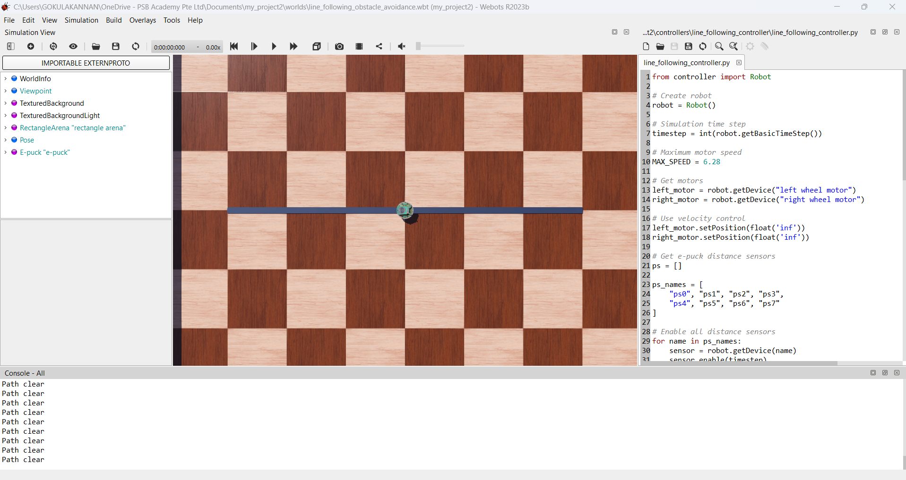
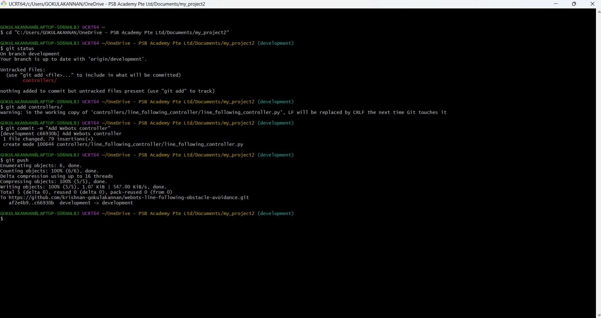

# Webots Line Following and Obstacle Avoidance

## Project Overview

This project focuses on developing a mobile robot in Webots that can follow a designated path and detect and avoid obstacles using sensor-based control.

## Development Environment

- Simulation: Webots R2023b
- Robot: e-puck
- Programming Language: Python
- Version Control: Git and GitHub

## Current Progress

The Webots simulation environment has been configured and the robot controller has been developed to read the e-puck distance sensors.

The current controller can:
- Read distance sensor values
- Detect nearby obstacles
- Display obstacle detection status
- Perform basic obstacle avoidance behaviour

## Git Workflow

The project uses Git and GitHub for version control.

Main Git workflow:

1. Edit project files
2. `git add`
3. `git commit`
4. `git push`

The repository uses separate branches:

- `main` – main project version
- `development` – ongoing development and testing

## Project Evidence

### Webots Simulation

The following screenshot shows the current Webots simulation environment used for the project.

### Git Workflow

The following screenshot shows the Git workflow used for the project, including staging, committing, and pushing changes to the GitHub repository.

## Project Management

Trello is used to plan and track project tasks, including task status, checklists, labels and due dates.